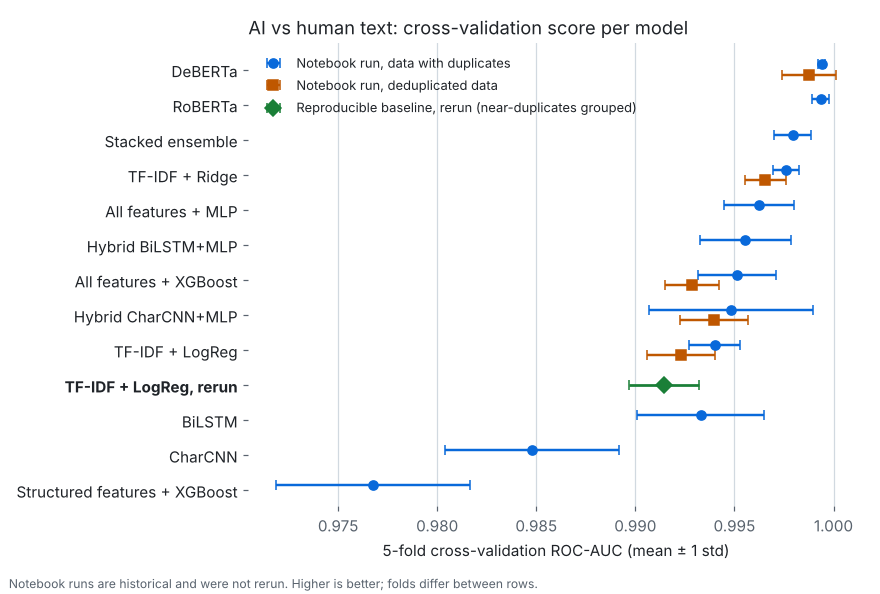
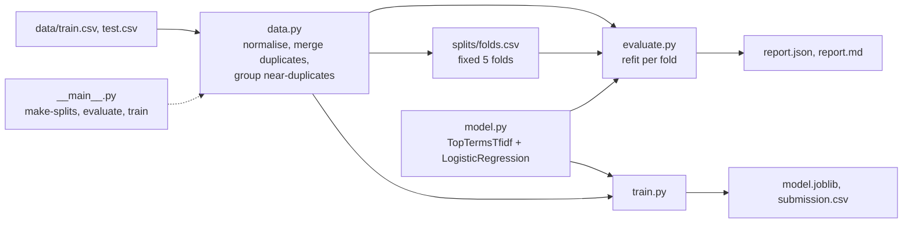

# Kaggle competition work: AI-text and bot detection

**Status: paused.** Both competitions are closed. The AI-vs-human text
baseline is kept reproducible and is tested in CI; the notebooks are records
and are not maintained.

Two text and tabular classification competitions from the BT4012 course
(2025): telling AI-written text from human text, and telling Twitter bots
from people. Each project goes from exploration to a model comparison, and
the AI-text project has a small baseline you can rerun from a fresh clone in
about a minute on a laptop CPU.

- Rerun a TF-IDF and logistic regression baseline for AI-vs-human text on
  fixed 5-fold splits and get the same scores, fold by fold
  (`python -m textbaseline evaluate`).
- Merge duplicate texts and keep near-duplicates in one fold: exact copies,
  and copies that share their first 100 normalised characters, stay in one
  fold. Copies with text added at the start can still cross folds (27 pairs,
  about 1e-4 ROC-AUC; see the [baseline report](ai-vs-human-text/baseline/REPORT.md)).
  The evaluation refuses to run if the folds do not match the data.
- Write a report: `report.json` holds the per-fold metrics, the data's
  SHA-256, and the package versions; `report.md` has the mean ± std, data
  counts, and error examples. `train` writes a Kaggle submission file.
- Browse the competition notebooks: 12 model variants from TF-IDF to
  DeBERTa-v3 for AI text, and gradient boosting, MLPs, and ensembles for bot
  detection.

<picture>
  <source media="(prefers-color-scheme: dark)" srcset="docs/media/cv-results-dark.png">
  
</picture>

The green diamond is the baseline, rerun in October 2026. The other points
are historical notebook runs that were not rerun. Notebook folds were drawn
per notebook, so treat small gaps between rows as noise. The chart comes from
[`docs/media/make_results_chart.py`](docs/media/make_results_chart.py).

## Quickstart

Needs Python 3.12 and git. No GPU, dataset download, or API keys: the
competition data is in the repository.

```bash
git clone https://github.com/KoalaLyfestyle/Kaggle.git
cd Kaggle/ai-vs-human-text/baseline
python3.12 -m venv .venv && source .venv/bin/activate
pip install -r requirements.lock

python -m pytest -q              # fixture smoke tests, plus a rerun checked against the committed report
python -m textbaseline evaluate  # 5-fold CV on the committed training data
python -m textbaseline train     # fit on all texts, write a submission
```

Expected output:

```text
22 passed in ...s
ROC-AUC 0.9915 ± 0.0018; report: .../baseline/runs/evaluate/report.json
model: .../baseline/runs/train/model.joblib; vocabulary 10000
submission: baseline/runs/train/submission.csv (1178 rows)
```

In `runs/evaluate/report.json`, ROC-AUC matches the committed
[`reports/tfidf-logreg/report.json`](ai-vs-human-text/baseline/reports/tfidf-logreg/report.json)
exactly on every fold, and the other metrics match to within 1e-6. More options are in the [baseline README](ai-vs-human-text/baseline/README.md).

## How it works



The package `ai-vs-human-text/baseline/textbaseline/` reads the training
texts and gives each one an ID from its normalised form: letters and digits
in any script, after NFKC, case-folded. So copies that differ only in case,
spacing, or punctuation merge, copies with conflicting labels are dropped,
and texts whose normalised form shares its first 100 characters form a group. The fold file
assigns every text and group to one of five folds and is checked against the
data before each run. For each fold, the vectorizer and classifier are fitted
on the other four folds only, and a test checks that no validation text
reaches a fit. CI runs the tests and a fixture evaluation on every change to
the baseline or the data.

## Results and limits

| | Score | Source |
|---|---|---|
| Baseline, rerun, near-duplicates grouped | CV ROC-AUC 0.9915 ± 0.0018, log loss 0.248 | rerun from a fresh clone on 19 October 2026 |
| TF-IDF + LogReg notebook, deduplicated | CV ROC-AUC 0.9923 ± 0.0017 | historical |
| DeBERTa-v3, deduplicated (final pick) | CV ROC-AUC 0.9988 ± 0.0013, public 0.99952, private 0.99943 | historical, not reproduced |
| AI-vs-human competition | 32nd of 113 on the private leaderboard, down 13 places from public | historical |
| Bot detection competition | 75th of 117 on the private leaderboard, down from 22nd public | historical |

Historical numbers come from the notebooks' saved CSVs and the project
write-ups. They were not rerun here.

**The overfitting lesson.** In the bot competition I picked the model with the
higher public score (0.94303 public) over one that scored lower in public
(0.94115) but generalized better (0.94466 private against 0.94327). The public
board was 30% of the test set. That choice cost about 0.0014 ROC-AUC and
roughly 30 places. In the AI-text competition I chose by cross-validation and
data quality instead, and the gap to the best available submission fell to
0.00001.

**Limits.**

- The DeBERTa cross-validation is optimistic: it stopped early on the same
  fold it reports.
- Most notebook runs used data with 500 duplicate rows and ungrouped folds,
  which inflates CV. 18% of the test rows also appear in the training data.
- The baseline is a reference point, not the best model. It misses AI text
  written in a plain, specific style and flags polished human writing.
- The data has no recorded source or licence in this repository.

Details: [baseline report](ai-vs-human-text/baseline/REPORT.md),
[model card](ai-vs-human-text/baseline/MODEL_CARD.md),
[AI-vs-human write-up](ai-vs-human-text/README.md#results), and
[bot detection write-up](twitter-bot-detection/README.md#results-1).

## Design note

**A choice:** the baseline breaks ties at the vocabulary cutoff
alphabetically (`TopTermsTfidf` in `model.py`). Plain `TfidfVectorizer`
breaks them with an unstable sort, and the same run gave different scores on
x86 and Apple silicon. A test now reruns the evaluation and compares it with
the committed report, so a result in this README can be checked, not trusted.

**What was cut:** rerunning DeBERTa on the fixed folds. It needs a GPU and the
notebook's Colab layout, so its numbers stay labelled historical.

## More

- [The competition notebooks](docs/notebooks.md): what each one does and how
  to open them.
- [twitter-bot-detection/README.md](twitter-bot-detection/README.md) and
  [ai-vs-human-text/README.md](ai-vs-human-text/README.md): full write-ups.

If this is useful to you, a star or a fork is appreciated.
